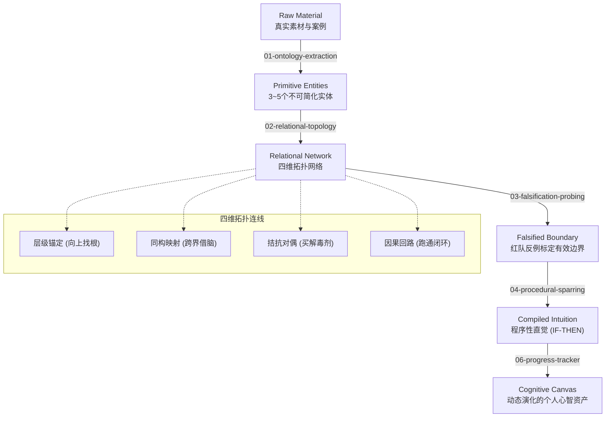

# Mental Modeling Skills (思维建模与认知脚手架技能集)

> **基于认知科学与毛选《实践论》的领域思维建模、学习进度追踪与 AI 对抗训练技能库。**  
> 专为 Cursor / Codex / Claude Code / Antigravity 等 AI Agent 设计。帮助你告别“看了 AI 总结以为懂了，一上手全忘”的假象，建立真正属于自己的高维认知网络与实战直觉。

---

## 核心架构：心智编译流水线



---

## 快捷指令系统 (Slash Commands)

如果你在 **Cursor / Windsurf / Claude Code** 中使用本项目，只需输入以下指令即可瞬间唤醒对应能力的 AI 陪练导师：

| 指令 | 阶段 | 导师行为与认知目标 |
| :--- | :--- | :--- |
| **`/start <领域>`** | 阶段 1：素材与本体 | 先给 3 个极端争议案例，再提炼底层 3~5 个不可简化硬实体并定义边界 |
| **`/link`** | 阶段 2：四维网络拓扑 | 引导建立：向上锚定父节点、跨界同构映射、拮抗对偶平衡项、动力因果回路 |
| **`/redteam`** 或 **`/roast`** | 阶段 3：红队反例打靶 | 针对当前模型无情找茬，列出 3 个真实反例击碎脆弱假想，标定失效禁区 |
| **`/spar`** | 阶段 4：两难对抗沙盒 | 抛出无选项、无提示的真实一线灰度死局，强迫决断，无情剖析代偿代价 |
| **`/audit`** | 阶段 5：画布进度审计 | 诊断《领域认知画布》当前成熟度（L1~L5），指出盲区并定制 3 天冲刺清单 |

---

## 3 分钟极速上手

### 步骤 1：一键初始化你的领域工作区
本项目内置纯 Python 零依赖初始化脚本，一行命令即可生成完整的独立学习沙盒：

```bash
# 进入仓库目录
python scripts/init_domain.py "分布式系统" "解决微服务容灾与数据一致性难题"
```

脚本将自动在 `domains/` 下生成专属工作目录与预置文档：
- `domains/分布式系统/CANVAS.md`（你的领域认知画布主档案）
- `domains/分布式系统/01_materials_and_entities.md`
- `domains/分布式系统/02_relational_topology.md`
- `domains/分布式系统/03_falsification_probing.md`
- `domains/分布式系统/04_sparring_and_decisions.md`

### 步骤 2：启动 AI 对练
打开 Cursor、Claude Code 或 ChatGPT 对话框，输入：
```text
/start 分布式系统
```
AI 将立即按照《实践论》逻辑，先用具体案例带你浸润体感，随后抽离核心本体。

### 步骤 3：持续沉淀至认知画布
将每一阶段对练生成的实体、拓扑、反例与产生式沉淀在 `CANVAS.md` 中。  
学习几天后，随时输入 `/audit`，让 AI 对你的画布进行成熟度健康度审计。

---

## 技能矩阵 (Skills Index)

| 目录编号 | 技能名称 | 核心定位与认知科学原理 | 适用场景 |
| :--- | :--- | :--- | :--- |
| **01** | [`01-ontology-extraction`](./skills/01-ontology-extraction/SKILL.md) | **本体抽取与概念降维**<br>· 认知负荷控制与图式理论<br>· 剥离黑话，抓取 3~5 个不可简化底层实体 | 面对陌生复杂领域感到信息混乱、无从下手时 |
| **02** | [`02-relational-topology`](./skills/02-relational-topology/SKILL.md) | **知识网络与四种关联建模**<br>· 奥苏贝尔层级锚定（找父节点）<br>· 根特纳结构映射同构（跨界借脑）<br>· 拮抗对偶（张力平衡）与动力因果回路 | 概念零散、记不住、需要建立高维直觉网络时 |
| **03** | [`03-falsification-probing`](./skills/03-falsification-probing/SKILL.md) | **反例证伪与红队压力测试**<br>· 约翰逊-莱尔德反例推理理论<br>· 皮亚杰认知顺应与边界标定 | 验证模型有效性、破除教条、寻找极端反例时 |
| **04** | [`04-procedural-sparring`](./skills/04-procedural-sparring/SKILL.md) | **程序性编译与两难交互沙盒**<br>· 安德森 ACT-R 产生式（IF-THEN）编译<br>· 认知学徒制两难情境实战对练 | 理论都懂但不会操作、需要高密度实战决断时 |
| **05** | [`05-domain-modeling-master`](./skills/05-domain-modeling-master/SKILL.md) | **领域思维建模全流程总控**<br>· 串联 01~04 阶段，引导端到端突破新领域 | 从零进入全新行业/学科，需要 AI 全程脚手架引导时 |
| **06** | [`06-progress-tracker`](./skills/06-progress-tracker/SKILL.md) | **认知进度追踪与画布审计**<br>· Dreyfus 成长模型与 ACT-R 状态审计<br>· 诊断认知卡点，规划针对性对练冲刺 | 定期复盘、追踪认知模型演化与实战进度时 |

---

## 官方实战范例 (Examples)

不知道画布怎么填？项目中提供了教科书级别的完整范例供你参考：

- 📘 [**认知心理学完整实战认知画布** (`examples/cognitive-psychology/CANVAS.md`)](./examples/cognitive-psychology/CANVAS.md)：
  - **4 大硬实体**：注意（带宽）、工作记忆（RAM）、图式（SSD索引）、产生式（IF-THEN）
  - **操作系统同构**：注意力=CPU时间片调度，焦虑=内存泄漏
  - **红队反例**：看不见的大猩猩（不注意视盲）、白熊实验（认知压抑反弹）
  - **两难沙盒实战**：战略投资汇报现场系统死锁与 CEO 公开批评的高压应对心智推演

---

## 认知哲学基石

> “理性认识是一棵树，它必须扎根在感性认识的土壤里才能活。” —— 毛泽东《实践论》  
> “你的知识如果只是孤立的散点，你根本无法使用它们；你必须把经验悬挂在由多个模型组成的格栅网络上。” —— 查理·芒格  
> “认识是一切改变的开始。而真实的认识，是无法外包的。”

---

## 开源协议

本项目采用 [MIT License](./LICENSE) 开源协议。欢迎 Star、Fork 与提交 PR 分享你在各个技术/商业/认知领域的实战认知画布！
